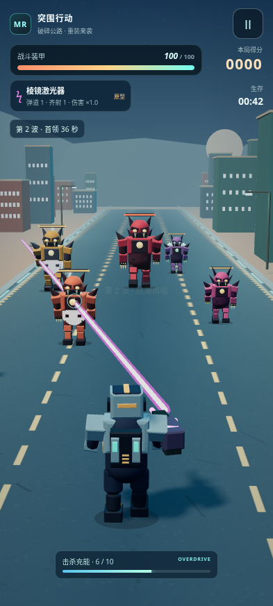

# 怪潮突围 · Monster Rush 2.1

原创第三人称竖屏 3D 生存射击。沿曙光中的废城公路突围，选择强化路线，把单兵火力逐步推进到穿透光束与等离子弹幕。

实际 WebGL 战斗画面（自动化测试场景）：



[查看 Boss 战预览](docs/boss-2.1.png)

## 怎么玩

- 按住屏幕左右拖动，角色会辅助瞄准并自动开火；落指时不会突然跳到另一条路线。
- 左右全息门只领取其中一个。射击可以为门充能，子弹仍能继续打向敌人。
- 弹道、追加弹丸、射速、弹速、伤害分别成长；暂停面板可查看完整属性。
- 每 10 点击杀充能触发 6 秒火力过载：射速 ×1.5、伤害 ×1.25。精英怪提供更多充能。
- 拾取五种实体武器补给，获得不同模型、射击模式和声音。维修箱恢复 25 点装甲；重复或较低阶的武器补给会校准当前武器并修复装甲，不会强行降级；已满阶的属性门转为维修门。
- 怪潮每 24 秒留出短暂间歇。首个 Boss 在约 78 秒到来，有地面攻击预警，以及两次清晰可见的护盾重组阶段。

音乐与音效可分别调整。最高分和音量保存在本机，切换应用时自动暂停。

## 本地运行

游戏无需构建、后端或联网 API。仓库根目录运行：

```sh
python3 -m http.server 8000
```

访问 `http://localhost:8000/`。Three.js 已固定并保存在仓库，角色、道路、武器、图标与分层战斗音乐均由项目原创程序生成。

## 自动验证

Node.js 22 或更新版本：

```sh
npm ci
npx playwright install chromium
npm test
```

Playwright 仅用于开发测试，运行游戏不加载任何 npm 包。测试会自行启动本地静态服务器，并在 `/monster-rush-mobile/` 子路径运行 Chromium；若使用系统 Chromium，可设置 `CHROMIUM_PATH=/usr/bin/chromium`。已有外部 Playwright 安装的环境可通过 `PLAYWRIGHT_MODULE` 指定模块路径。

测试覆盖触摸移动、五类真实属性、所有武器击杀、激光对 Boss 的伤害、快速弹丸路径碰撞、穿门射击、单次门奖励、过载、维修补给、阶段护盾、音量分流、存档、暂停、死亡、重新开始及离线启动。另有 180 秒有保护的容量测试，以及正常血量下原地射击与主动操作的对比模拟。它们不代表安卓真机帧率或真人难度评价。

截图和结构化结果写入忽略提交的 `test-results/`。仅 `?test=1` 页面暴露测试接口，正常游戏不会启用这些接口。GitHub 的 `Game checks` 工作流在 Pull Request 和 `main` 更新时运行同一套检查。

## 发布与离线安装

现有 GitHub Pages 工作流在 `main` 更新时发布。仓库 **Settings → Pages → Build and deployment → GitHub Actions** 应选择 GitHub Actions。所有运行资源使用相对路径，兼容仓库子目录。

Service Worker 缓存游戏及本地 Three.js 模块，支持缓存后的离线启动。发布更新时同步修改 `sw.js` 的缓存版本；新 Worker 接管时清除旧缓存。安装清单包含 192×192 与 512×512 PNG 图标。

## 许可

`vendor/three/three.module.min.js` 为 Three.js `0.170.0`（r170），遵循 MIT License；原文见 `vendor/three/LICENSE`。未引入其他商业游戏的角色或素材。
